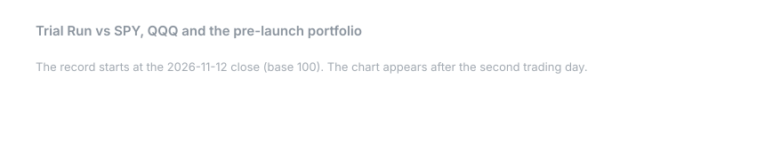
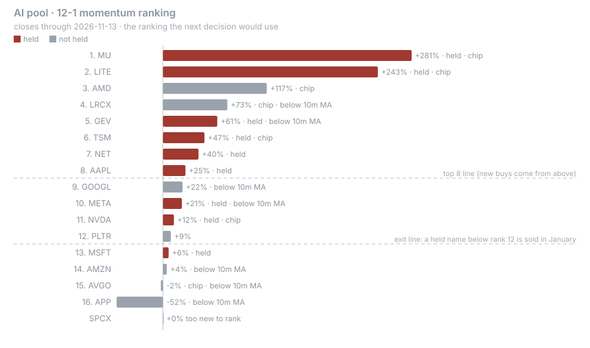
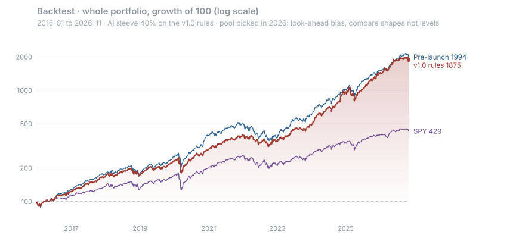
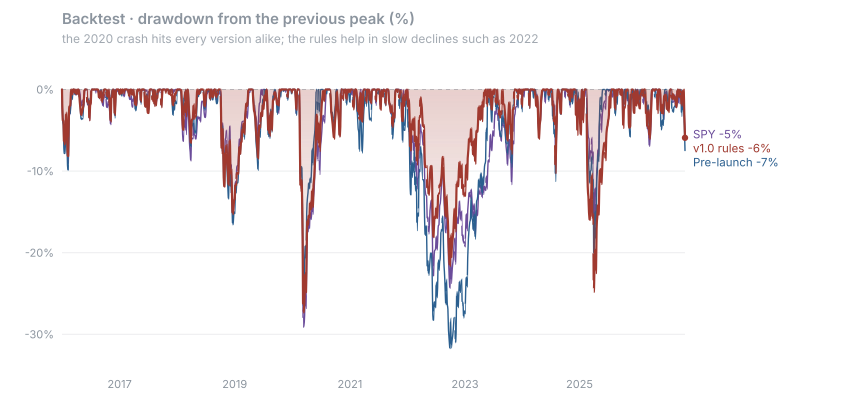
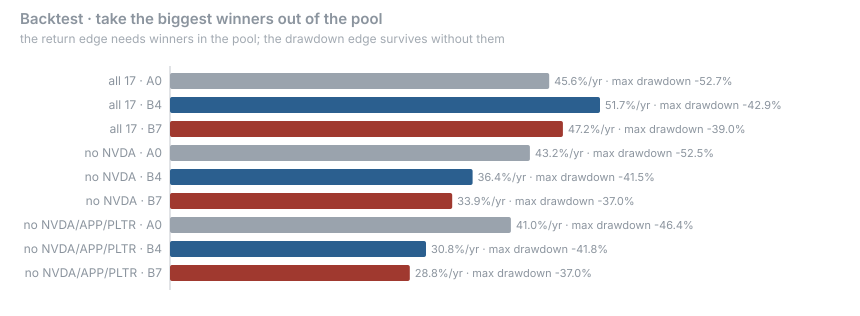
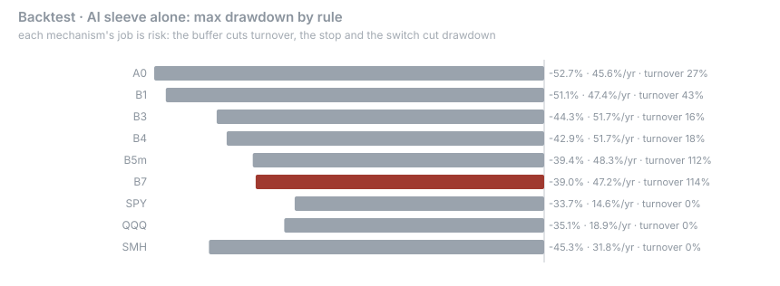

# Trial Run · 小试牛刀

> A forward-tracked paper portfolio of U.S. equities: a 40% AI sleeve that rotates by written rules, five fixed
> sleeves the author understands, and a Treasury reserve. The rules were frozen and published before the record
> began, and the record is never backfilled. It is a test of a method, not a track record, and nothing here is
> investment advice.

[](https://github.com/klaywang24/trial-run/actions/workflows/daily.yml)
[](LICENSE)
[](METHODOLOGY.md)
[](data/ledger/)
[](#what-it-promises)
[](README.zh.md)



The chart updates after every US close. Pre-launch is the portfolio as it stood the day before launch, left
untouched: it answers whether the rules add anything over doing nothing.

---

## What it promises

It does not promise to beat SPY, QQQ or anything else. It promises three things:

1. Rules first, results second. The methodology was committed, hashed and timestamped before the first close
   was recorded. A workflow refuses to run if the rules file changes without a dated `methodology:` commit.
2. Every number has a source. Prices are Yahoo adjusted closes; borderline ranking decisions are checked against
   a second source and the check is committed.
3. No backfill, no deletions. Losing days, losing names and wrong calls stay in the ledger.

---

## The structure

| Sleeve | Target | Holdings | Rotates |
|---|---|---|---|
| AI chain | 40% | 8 or more names from a 17-name pool, by rule | Yes |
| Sports | 10% | GRMN 6%, MSGK 4% | No |
| Fintech | 10% | V 4%, MA 3%, AXP 3% | No |
| Health care and energy | 10% | LLY 5%, XLE 5% | No |
| Income | 10% | SPDV | No |
| Defense | 10% | KO 5%, BRK.B 5% | No |
| Reserve | 10% | BIL (short-term Treasuries) | No |

AI pool (17): AAPL, NVDA, MSFT, META, AMZN, GOOGL, AMD, NET, MU, LRCX, APP, GEV, LITE, PLTR, TSM, AVGO, SPCX.
New listings join the ranking after 253 trading days.

AI holdings at inception (share of the whole portfolio): NVDA 6.6%, MU 5.3%, AAPL 5.1%, TSM 4.9%, NET 4.8%,
META 4.4%, MSFT 3.5%, GEV 3.5%, LITE 1.8%. Sold at launch: PLTR, AMZN, AVGO (ranked 13 to 15).
[How this was decided](METHODOLOGY.md#4-ai-sleeve-rules), and the [full ranking](data/ledger/inception_ranking.csv).

## The AI rules in one screen

| When | What happens |
|---|---|
| First trading day of January | Rank the pool by 12-1 momentum. Keep held names ranked 12 or better; fill up to 8 from the top. New names get 1/8 of the sleeve; kept names keep their proportions (winners are not cut back to equal weight) |
| Any time a name passes 20% of the sleeve | Trimmed to 20% at the next annual or quarterly check |
| First trading day of Apr, Jul, Oct | A name below its 10-month average and ranked below 12 is halved into SPY |
| First trading day of every month | If SPY closed last month below its 10-month average, half of every AI holding moves to SPY until it recovers |
| Annual selection | Chip names together at most 60% of the sleeve |
| Every close | Any holding off target by more than 50% (relative) resets all sleeves to target |



---

## What the backtest says, and what it cannot say

The pool was chosen in 2026, so any backtest of it carries look-ahead and survivorship bias. Treat the returns as
a ceiling, not an expectation; compare rules with each other. Rerun it yourself with `python -m backtest.run_backtest`.

| 2016-01 to 2026-11 | Annual return | Max drawdown | 2022 | 2025 | Tracking error vs SPY |
|---|---|---|---|---|---|
| v1.0 rules | 31.4% | −31.5% | −21.7% | −26.6% | 8.1% |
| Pre-launch holdings, rebalanced quarterly | 32.1% | −32.8% | −31.9% | −23.3% | 8.8% |
| SPY | 14.6% | −33.7% | −24.5% | −18.8% | 0 |





Three findings decided the design:

1. Picking the pool sets the return; the rules shape the risk. With the three biggest winners removed, the rules
   earn less than simply holding the whole pool, but their drawdown stays smaller.
   
2. Each mechanism earns its place on risk, not return. The buffer cut turnover from 43% to 16% a year. The stop,
   the market switch and the chips cap together cut the AI sleeve's worst drawdown from −44% to −39%.
   
3. No rule stops a fast crash. 2020 and 2025 hit every version. The switch was kept for slow bear markets
   like 2000 to 2002, which this window does not contain. The cost in this window was about 1.7 points a year.

---

## Follow along

| File | What it holds |
|---|---|
| [`data/ledger/nav.csv`](data/ledger/nav.csv) | Daily level, SPY, QQQ, Pre-launch, AI weight, switch state, events |
| [`data/ledger/trades.csv`](data/ledger/trades.csv) | Every trade with date, price and the rule that caused it |
| [`data/ledger/positions.csv`](data/ledger/positions.csv) | Units held now |
| [`data/ledger/ai_ranking_latest.csv`](data/ledger/ai_ranking_latest.csv) | Today's ranking and which line each name sits on |
| [`config.yaml`](config.yaml) | The frozen parameters ([hash](FROZEN.sha256)) |
| [`ERRATA.md`](ERRATA.md) · [`POOL_CHANGES.md`](POOL_CHANGES.md) | Corrections and pool changes |

Next scheduled events: market switch check on 2026-12-01; first annual selection on 2027-01-04.

## Run it yourself

```bash
python -m venv .venv && .venv/bin/pip install pandas pyyaml yfinance
.venv/bin/python -m tests.check_frozen && .venv/bin/python -m tests.test_rules
.venv/bin/python -m src.daily && .venv/bin/python -m src.render
.venv/bin/python -m backtest.run_backtest
```

## License

[PolyForm Noncommercial 1.0.0](LICENSE): free for noncommercial use; commercial use needs a separate license.

## Disclaimer

Everything here is for information and research. It is a simulated portfolio, not investment advice, and not a
recommendation to buy or sell any security.
