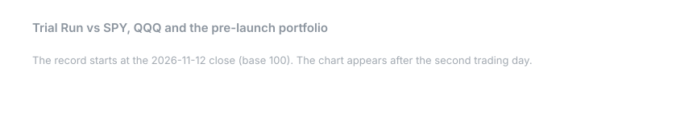
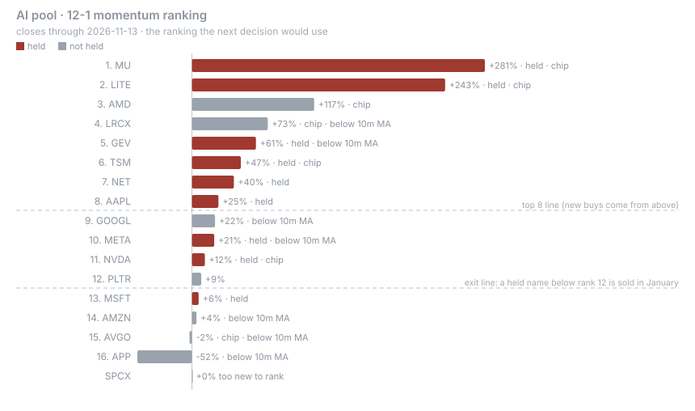
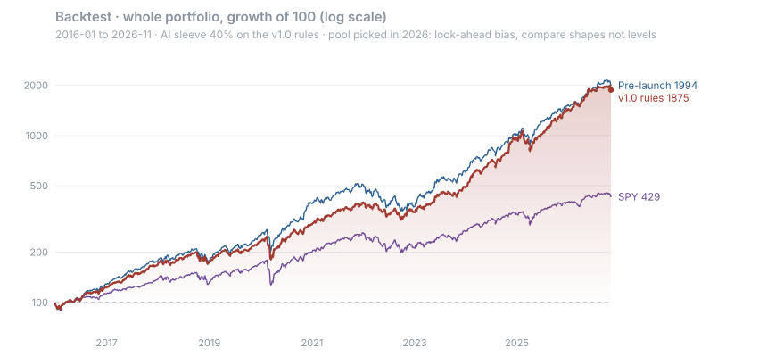
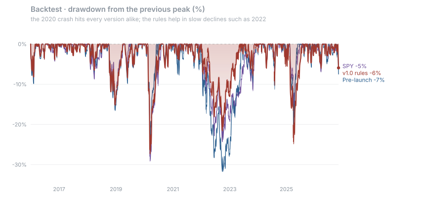
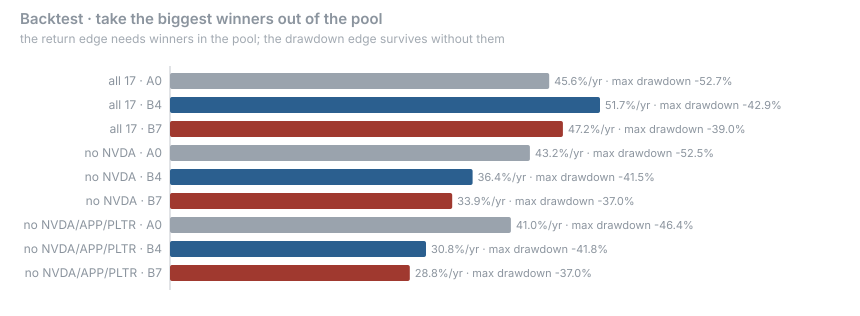
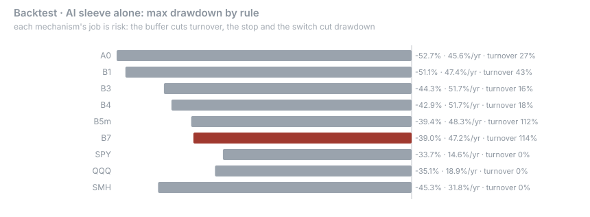

# 小试牛刀 · Trial Run

> 一个向前记录的模拟美股组合：AI 仓占 40%，按写好的规则轮换；另外五块是作者看得懂的行业，不轮换；再留 10% 短期美债。规则在记录开始之前冻结并公开，记录从不回填。这里检验的是方法，不是业绩记录，所有内容都不构成投资建议。

图在每个美股交易日收盘后自动更新。Pre-launch 是起始前一天的原持仓，原样不动。它回答一个问题：规则比什么都不做强在哪里。

---

## 承诺什么

不承诺跑赢 SPY、QQQ 或任何指数。承诺三件事：

1. 先有规则，后有结果。 方法论在第一个收盘价记录之前提交，算了哈希，留了第三方时间戳。规则文件一改，自动运行就停，除非是带日期的 `methodology:` 提交。
2. 每个数字有出处。 价格用 Yahoo 调整收盘。排名在分界线上难分高下时，用第二个数据源复核，复核结果也提交进仓库。
3. 不回填，不删除。 亏钱的日子、亏钱的股票、判断错的地方，都留在记录里。

---

## 结构

| 仓位 | 目标 | 持仓 | 是否轮换 |
|---|---|---|---|
| AI 产业链 | 40% | 17 只股票池里按规则选 8 只或更多 | 是 |
| 体育 | 10% | GRMN 6%，MSGK 4% | 否 |
| fintech | 10% | V 4%，MA 3%，AXP 3% | 否 |
| 医疗与能源 | 10% | LLY 5%，XLE 5% | 否 |
| 现金流 | 10% | SPDV | 否 |
| 防守 | 10% | KO 5%，BRK.B 5% | 否 |
| 剩余 | 10% | BIL（短期美债） | 否 |

AI 股票池（17 只）： AAPL、NVDA、MSFT、META、AMZN、GOOGL、AMD、NET、MU、LRCX、APP、GEV、LITE、PLTR、TSM、AVGO、SPCX。新上市的公司满 253 个交易日后参加排名。

起始时的 AI 持仓（占整个组合）：NVDA 6.6%，MU 5.3%，AAPL 5.1%，TSM 4.9%，NET 4.8%，META 4.4%，MSFT 3.5%，GEV 3.5%，LITE 1.8%。起始时卖出 PLTR、AMZN、AVGO（排名第 13 到 15）。[怎么定的](METHODOLOGY.zh.md#4-ai-仓规则)，[完整排名](data/ledger/inception_ranking.csv)。

## AI 仓规则一览

| 时间 | 做什么 |
|---|---|
| 每年 1 月第一个交易日 | 按 12-1 动量排名。已持有且排名在 12 以内的留下，空位从排名最高的补到 8 只。新进的各占 AI 仓 1/8，留下的保持原有比例，赢家不会被削回等权 |
| 单只超过 AI 仓 20% | 下一次年度或季度检查时削到 20% |
| 4、7、10 月第一个交易日 | 跌破 10 个月均线并且排名在 12 以外的，减半换成 SPY |
| 每月第一个交易日 | 上月末 SPY 收在 10 个月均线下方，每只 AI 股票减一半换成 SPY，等 SPY 回到均线上方再换回 |
| 年度选股时 | 芯片股合计不超过 AI 仓的 60% |
| 每个交易日收盘 | 任何一个持仓偏离目标超过 50%（相对值），所有仓位调回目标 |

---

## 回测说明了什么，说明不了什么

股票池是 2026 年定的，所以回测有后视偏差和幸存者偏差。收益只能当作上限看，不能当预期，适合拿来比较不同规则。任何人都可以运行 `python -m backtest.run_backtest` 复现。

| 2016-01 至 2026-11 | 年化 | 最大回撤 | 2022 年 | 2025 年 | 对 SPY 跟踪误差 |
|---|---|---|---|---|---|
| v1.0 规则 | 31.4% | −31.5% | −21.7% | −26.6% | 8.1% |
| 起始前原持仓，季度再平衡 | 32.1% | −32.8% | −31.9% | −23.3% | 8.8% |
| SPY | 14.6% | −33.7% | −24.5% | −18.8% | 0 |

三个发现决定了设计：

1. 选对股票池决定收益，规则决定持有过程中的风险。 把三个最大赢家拿出池子以后，按规则选股的收益低于整池等权持有，但回撤仍然更小。
   
2. 每个机制的价值在风险上。 缓冲把年换手从 43% 降到 16%。季度止损、市场开关、芯片上限加在一起，把 AI 仓最大回撤从 −44% 降到 −39%。
   
3. 急跌挡不住。 2020 年和 2025 年，每个版本都一起跌。保留市场开关，是为了 2000 到 2002 年那种慢熊，这个回测窗口里没有。它在这个窗口里的代价是每年约 1.7 个点。

---

## 跟踪

| 文件 | 内容 |
|---|---|
| [`data/ledger/nav.csv`](data/ledger/nav.csv) | 每日净值、SPY、QQQ、Pre-launch、AI 仓权重、开关状态、当天事件 |
| [`data/ledger/trades.csv`](data/ledger/trades.csv) | 每笔交易的日期、价格和触发它的规则 |
| [`data/ledger/positions.csv`](data/ledger/positions.csv) | 当前持有的份额 |
| [`data/ledger/ai_ranking_latest.csv`](data/ledger/ai_ranking_latest.csv) | 最新排名，以及每只股票在哪条线上 |
| [`data/ledger/pnl_by_holding.csv`](data/ledger/pnl_by_holding.csv) | 每只持仓每天贡献的盈亏点数，加起来等于当天净值变化 |
| [`output/dashboard.html`](output/dashboard.html) | P&L 看板：日、周、月、年的盈亏日历，每段时间的收益和回撤来自哪些票。[在线打开](https://klaywang24.github.io/trial-run/output/dashboard.html) |
| [`config.yaml`](config.yaml) | 冻结的参数（[哈希](FROZEN.sha256)） |
| [`ERRATA.md`](ERRATA.md) · [`POOL_CHANGES.md`](POOL_CHANGES.md) | 勘误和股票池变更 |

接下来的事件：2026-12-01 第一次检查市场开关；2027-01-04 第一次年度选股。

## 许可证

[PolyForm Noncommercial 1.0.0](LICENSE)：非商业用途免费；商业用途需另行授权。

## 免责声明

本仓库所有内容仅供信息与研究参考。这是模拟组合，不构成投资建议，不推荐买卖任何证券。
